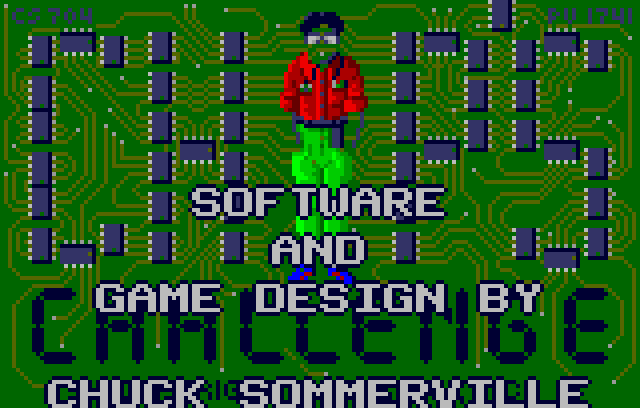

# chipschallenge-lynx-recomp

**A static recompilation of *Chip's Challenge* (Atari Lynx, 1989) — the first
game ever brought up on [`lynxrecomp`](https://github.com/sp00nznet/lynxrecomp),
and (as far as we know) the first Lynx game turned into a native executable.**



*The image above is rendered by the recompiled C — Chip's 65SC02 code translated
to native C and executed directly (no interpreter), driving the emulated Suzy
blitter. The 4-channel attract music plays too.*

*Chip's Challenge* was the Lynx launch puzzle game: a tile-grid maze where Chip
collects chips, dodges monsters, and juggles keys and boots across 100+ levels.
It's an ideal first recompilation target — deterministic tile logic, flat sprite
blits, little of the hardware sprite-scaling that makes the Lynx's pseudo-3D
games hard.

This repository is the **reference game**: it pulls in the `lynxrecomp` toolkit
as a submodule, adds the per-game host that runs the recompiled C, and builds a
native executable. The reusable recompiler itself lives in
[`lynxrecomp`](https://github.com/sp00nznet/lynxrecomp) — fork that to recompile a
different Lynx game.

> **No ROM here.** The cartridge dump and the recompiler-generated C (which is
> derived from it) are not committed. Supply your own
> `Chip's Challenge (USA, Europe).lnx` — sha1 `92af2d566c6bbf626a21dbfa41af16d73e0a774d`.
> A placeholder keeps the build green until you generate the real C.

## Status — runs the recompiled C

The full chain works: boot decrypt → RAM image → **317 recompiled functions
(~62 KB, zero dispatch gaps)** → native execution → the title screen renders and
the music plays. The CPU code is genuinely recompiled to native C; only the
fixed-function Suzy/Mikey hardware is emulated (by the toolkit runtime).

The host (`games/chipschallenge/src/main.c`) loads the RAM image, registers the
recompiled functions, and calls the game entry (`$18B7`). It links **no
interpreter** — it can only run the translated C. The runtime's cooperative ticks
drive the timers and deliver the VBL interrupt into the recompiled handler; the
recompiled game builds its sprite lists and the emulated blitter draws them.

Still to do: full-fidelity cold boot through the recompiled reset, interactive
input in the host, and the blitter's hardware scaling/collision (which the
title screen doesn't need).

## Build & run

You need the toolkit (built from the submodule), your cart dump, and the Lynx
boot ROM (`lynxboot.img`, the standard 512-byte image other emulators use).

```powershell
git clone --recurse-submodules https://github.com/sp00nznet/chipschallenge-lynx-recomp
cd chipschallenge-lynx-recomp
cmake -S . -B build && cmake --build build --config Release   # builds toolkit + host
$T = "build/lynxrecomp/tools/m65c02recomp/Release"

# 1. boot the cart to a post-init RAM image (jump tables built)
& $T/lynxrun.exe --snapshot "Chip's Challenge (USA, Europe).lnx" lynxboot.img ram.bin 60

# 2. recompile, seeding the computed-jump targets so there are no gaps
& $T/m65c02recomp.exe recompbin ram.bin 0x0000 games/chipschallenge/generated `
    0x18B7 0x2D0E 0x2E2C 0x2701 0x7D1B

# 3. rebuild the host against the generated C, then run it
cmake --build build --config Release
& build/games/chipschallenge/Release/chipschallenge.exe ram.bin 400 title.ppm
```

The host renders to a PPM; if it reports any "unrecompiled addr" gaps, add them
as seeds in step 2 and repeat (iterative seed-closure). To hear the attract
music: `lynxrun --audio "Chip's Challenge (USA, Europe).lnx" lynxboot.img music.wav 25`.

## Layout

```
lynxrecomp/                      the toolkit (git submodule)
games/chipschallenge/
  src/main.c                     host: load image, register, run recompiled C
  generated/                     recompiler output (ROM-derived; placeholder kept)
  chipschallenge.hints.txt       analyzer hints for this title
screenshots/                     title.png, recompiled-title.png, credits.png
docs/NOTES.md                    game-specific findings + the build workflow
```

See [`docs/NOTES.md`](docs/NOTES.md) for the boot flow, the discovered entry
points, and details, and the toolkit's
[`ROADMAP.md`](https://github.com/sp00nznet/lynxrecomp/blob/main/ROADMAP.md).

## License

MIT — see [`LICENSE`](LICENSE). *Chip's Challenge* is a trademark of its
respective owner; this project ships no game data and is an independent
preservation/recompilation effort.
